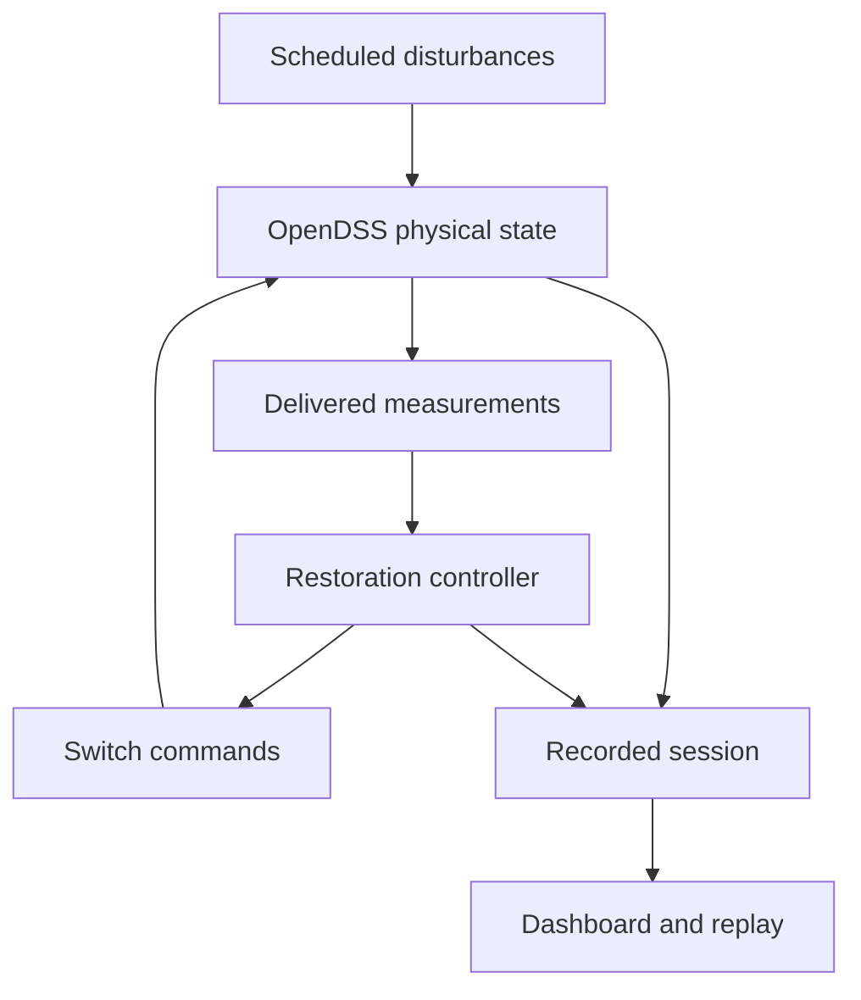
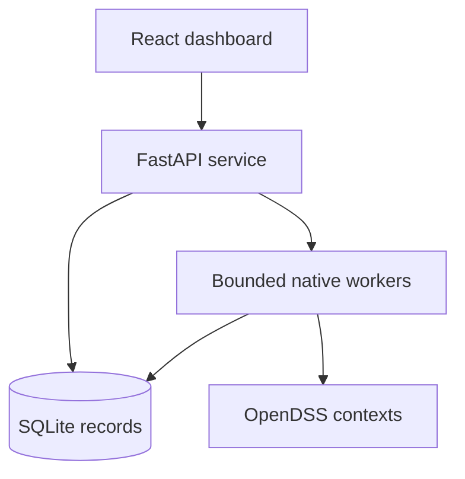

# Architecture and data flow

GridSense has one Python simulation backend and a React dashboard. The backend
owns electrical calculations, the simulation clock, controller decisions and
saved records. The dashboard displays those records and submits user actions.
Live operation, incident analysis and controller tests use the same native
electrical adapters.

## Application

GridSense is a modular Python application with a React client. FastAPI owns
request validation and orchestration. A two-process worker pool runs native
simulation work so requests do not execute OpenDSS inside the event loop.
Workers exit after each bounded job and are replaced. This releases native
contexts retained by the pinned wrapper instead of accumulating them across
requests. Circuit calculations stay in the same native adapters; process startup
adds overhead to each request.

Snapshot jobs return completed results to the service for storage. Session jobs
commit their native step directly in their own database transaction. Development
uses a Vite proxy; the source production build is served by the same FastAPI origin.

Static SVG views: [session flow](figures/session-flow.svg) and
[application components](figures/application-components.svg). The Mermaid blocks
above are their editable sources.

## Module responsibilities

`domain.py` defines Pydantic records and strict public request validation.
`network.py` reads the versioned circuit definition, derives connectivity and
owns healthy initialization plus outage/isolation/repair state transformations.
`electrical.py` owns the teaching feeder; `ieee13.py` owns the unbalanced reference/experimental adapter. Both use native OpenDSS. `planning.py` makes decisions using
observations. `service.py` separates observations from truth and evaluates the
decisions. `storage.py` owns SQLite transactions. `api.py` exposes those functions.
`failure_search.py` owns its validated request, bounded search, failure predicate,
reducer, and case reproduction. It calls the same `service.evaluate`; it does not
introduce a second electrical implementation. `FailureSearch.tsx` is a separate
dashboard module whose saved incidents open in Restoration lab and Decision evidence.

The frontend owns presentation, pending form edits, and which saved policy
outcome is being inspected. It does not calculate electrical feasibility,
choose a tie, or manufacture simulation output. Switching between policy views
does not apply a new physical command; it inspects an already recorded branch.

## Live sessions

`episodes.py` owns integer-second time, scheduled physical changes, and native
snapshots. `telemetry.py` owns sample generation, delay/drop delivery, and held
demand estimates. `rules.py` sees only received rows. `session_store.py` commits
each checkpoint, tick frame and action record in one SQLite transaction.
`session_api.py` paces those transactions through the same two-worker pool.
The browser owns no live-session clock. `useLiveSession.ts` polls committed
revisions and submits request IDs with optimistic revision checks. It retains
uncertain request payloads for idempotent recovery, including reload when browser
storage is available. Read errors block controls without fabricating state.

`LiveGrid.tsx` coordinates session selection and controls. `LiveTopology.tsx`
renders returned physical/electrical state; `LiveEvidence.tsx` separates that
truth from received rows, alarms, commands and predictions. `LiveScenario.tsx`
submits future events, not physical edits. `LiveAnalysis.tsx` captures exports and
lets the user inspect recorded ticks without changing the live clock. App navigation
groups the session timeline, snapshot comparisons and controller tests by task.
No simulator or planning algorithm is duplicated in the browser.

`restoration.py` constructs a prediction model with individual load powers taken
from received estimates, unity feeder factors and observed switch/availability
states. It searches ordered paths, projects held bounds to assumed switching times
and compares native transition energy over a common window. Graph service bounds
prune candidates; exact native problems are cached within one decision.
`control.py` owns the plan, attempts, confirmation wait, revalidation, recovery
preference and remembered overload exposures. Relevant availability and overload
changes can supersede its ordinary planning cooldown. `switching.py` owns device position changes and correlated feedback.
`episodes.py` separately executes private actuator events and records their true
outcomes. Prediction never receives those failure settings or future repairs.
The physical model is restored after every prediction solve; the next
physical snapshot reconstructs its own complete native circuit.

`restoration_reference.py` independently enumerates operation permutations and
ranks their feasible prefixes. Its candidate generation is separate; its native
adapter, uncertainty definitions and device load-set helper are shared. `episode_metrics.py` integrates
physical service over the fixed horizon. Neither the controller nor supply-status
labels read these evaluator metrics.

Snapshot jobs return their results to the service for storage. A session worker
owns the whole database transaction. A lost HTTP response can be retried with the original request
ID and revision to retrieve the same receipt. On restart, running sessions are
paused without advancing time. The service supports one local server process;
it is not a distributed session scheduler. The CLI reuses one native context
for its bounded episode, while the API releases each worker after a transaction.

The ordinary session endpoint exposes received observations and controller state.
The `/simulation` endpoint and export expose evaluator truth and future events.
This is a software information boundary, not access control: the local user can
inspect both. Strict replay regenerates the episode from its original definition
and committed actions, including queued actuation/feedback, delayed rows, commands,
rule state, decisions and energy accounting. See
[Live sessions](LIVE_SESSIONS.md) for schemas, ordering, limits, and examples.

## Snapshot comparisons

1. `POST /api/incidents` validates a `Scenario` and submits `evaluate` to a worker.
2. The service creates the true post-isolation state and an `Observation` with
   synthetic demand readings, timestamps, and stale/current quality labels.
3. Before calling either controller, true west demand is removed from the
   controller state. The planner reconstructs its own load factors exclusively
   from the observation. An integration test changes hidden truth while holding
   those inputs fixed and verifies identical decisions.
4. The planner discovers bounded switching alternatives from graph connectivity.
5. For each action, the electrical adapter rebuilds an independent state, applies
   the switching operation(s), solves, and evaluates electrical constraints.
6. The guarded controller repeats those evaluations at the lower and upper west
   demand assumptions. The nominal controller evaluates the reported demand only.
7. A privileged oracle uses true demand. It is a best-in-candidate-set reference,
   not a fair information-matched competitor or proof of global optimality.
8. The evaluator applies every candidate to the hidden true state. The incident
   stores both expected checks and actual simulated consequences.
9. SQLite saves the completed incident atomically. A failed simulation is not
   recorded as a successful incident. The client receives the saved payload.

## Isolation and electrical state

In Restoration lab, the assumed fault is on the incoming `feed_a` line. Both line terminals are open
and locked. Healthy downstream buses may be energized through a tie without
energizing the faulted section. The physical fault is not declared repaired.

The equipment workflow starts with `healthy_state()`. Availability
incidents, isolated transformer positions, source connection, line positions and
line lockouts are separate fields. `isolate_outage()` records an assumed
whole-device trip; `repair_outage()` clears one incident without closing a device.
`electrical.py` opens native terminals and disables disconnected load equations
while retaining their requested demand. MV connectivity and LV supply differ
when a distribution transformer is isolated. A subsequent state must be solved
and checked before its reconnection can be accepted. Clocked sessions expose
this equipment workflow through Live Grid, the API and CLI. Optional nominal/guarded control
plans restoration and recovery from delivered observations. Physical execution
enforces availability and radiality; an unobserved demand change can still produce
an electrical violation, which is retained in the next native snapshot.

The network graph supports structural reasoning. OpenDSS remains authoritative
for solved voltage, current, and power. Graph reachability is never counted as
proof that a restoration is electrically feasible.

Every `ElectricalEngine` owns a `dss.NewContext()`. Cases are reconstructed from
explicit parameters rather than depending on previous mutable native state.
The teaching model has no regulator/control history. The IEEE adapter
rebuilds explicit fixed regulator taps and passive capacitor state on each solve.
The temporal runner retains its complete bounded event inputs, device state and
message ordering; it does not simulate moving regulator controls or transients.

## Storage and replay

Each incident contains a circuit definition/hash, implementation hash, solver
version, true initial state, observations, decisions, recorded switching actions,
intermediate electrical results, final outcomes, and limitations.

Replay checks compatibility, reconstructs the recorded state, and reapplies each
recorded action in a fresh native context. It compares all recorded branch fields
using relative tolerance `1e-7` with a unit absolute floor. It does not recalculate
the original action by running the current policy again.

Review notes append records with timestamps. They do not change the incident,
retrain a model, establish ground truth, or imply multioperator adjudication.

Failure-search records add their configuration, method traces, reduction checks,
and original/reduced incidents. These are committed atomically in SQLite. The
failure-case reproduction endpoint combines a controller rerun with
electrical branch replay. Ordinary incident replay checks the recorded electrical branches.
Search records also pin the search implementation. Strict replay requires the
recorded implementation and solver identity; see [FAILURE_SEARCH.md](FAILURE_SEARCH.md).

## HTTP interface and storage

[API.md](API.md) lists all registered routes and the request/response boundaries.
[DATA_MODEL.md](DATA_MODEL.md) documents the nine SQLite tables and session commit
protocol. The API accepts bounded local simulation jobs; it does not expose
arbitrary DSS text, user code or filesystem paths.

## Controller-test boundaries

`cases.py` owns portable inputs and service contracts. `plants.py` creates a
teaching or IEEE adapter and constructs the permitted prediction view.
`controllers.py` implements a small selection protocol. `regression.py` alone
compares hidden-truth outcomes and historical baselines. `temporal.py` owns the
bounded event queue and execution trackers. `verification_api.py` registers the
controller-test routes using the same process pool and store; `Verification.tsx` is a thin
presentation client. Source fingerprints include formatting and text-decoding changes as well as
algorithm changes.

Controller-test routes are under `/api/verification`: `presets`, `cases/from-incident/{id}`,
`reference`, POST `regressions`, POST `temporal`, and `records/{id}` with `export`,
`replay`, and `rerun`. Records are immutable; rerun creates a new record. Refer to
[CONTROLLER_TESTING.md](CONTROLLER_TESTING.md) for information boundaries and replay.

## Evaluation boundary

`assurance.py` contains isolated experimental selectors, attribution, metering,
bounded reduction and strict defect replay. It imports the production controller
interface and evaluator; neither imports experimental variants. Experimental variants are kept out of the web controller
registry. `reference_checks.py` runs supplemental healthy-reference
checks in fresh native contexts; it does not set restoration acceptance rules.
`model_reference.py` owns the separately named published-voltage/model-envelope
comparison and numerical convergence study. It preserves the original comparator.
`experiments/protocols/` freezes inputs/tolerances, and `scripts/check_evidence.py`
checks results and replays event traces. `scripts/verify.py` is the common local/CI
entry point. See [ASSURANCE.md](ASSURANCE.md) for evidence and known mismatches.
