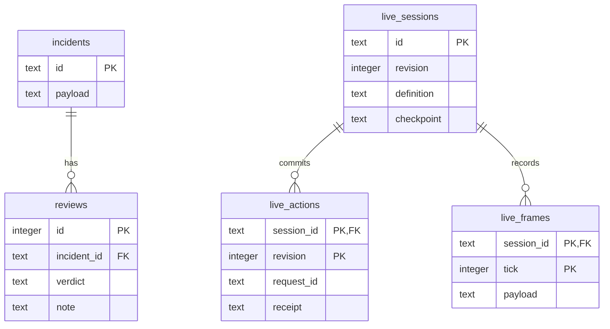
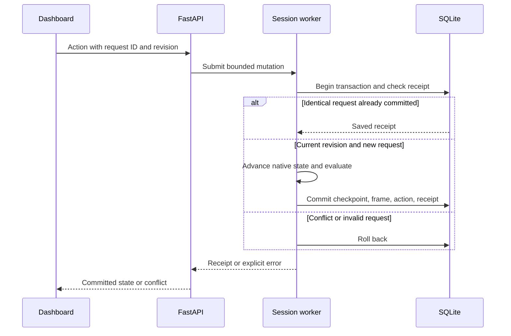

# Storage and record model

GridSense uses one SQLite database, created automatically at startup. Runtime
state is separate from the bundled circuit inputs and experiment data. There is
no external database service, default administrator or required seed import.

## Tables

| Table | Key | Content |
| --- | --- | --- |
| `incidents` | `id` | Scenario summary and complete immutable JSON electrical/decision evidence |
| `reviews` | integer `id`; FK `incident_id` | Append-only verdict, note and timestamp |
| `sweeps` | `id` | Fixed-observation case grid and manifest |
| `failure_searches` | `id` | Search request, traces, reduction and evidence incidents |
| `verification_runs` | `id` | Controller regression or temporal run and manifest |
| `live_sessions` | `id` | Definition, revision, pacing and complete committed checkpoint |
| `live_creations` | `request_id` | Creation payload digest and reusable receipt |
| `live_actions` | (`session_id`, `revision`); unique (`session_id`, `request_id`) | Mutation payload/digest, operation and committed receipt |
| `live_frames` | (`session_id`, `tick`) | Native state, observations, rules, decisions and evidence at each committed tick |

The unique request constraint on actions is scoped to its session. Other listed
tables hold independent JSON records; creation receipts reference their session
inside JSON rather than through a declared foreign key.

## Transaction boundary

Snapshot workers return completed results for service-side storage. A session
worker owns its whole database transaction, including revision validation,
native work, checkpoint, frame/action and receipt. SQLite WAL permits readers;
`BEGIN IMMEDIATE` serializes writers. A programming/storage failure rolls the
whole tick back. Native nonconvergence is represented as unknown measurements
and a pause rather than invented healthy readings.

A client retains an uncertain request after a lost response and retries that
same payload/ID. A duplicate returns its receipt without advancing another tick.
An incompatible payload or old revision is rejected. Startup pauses saved playback
without simulating elapsed wall time. This is a single local server design, not
a distributed exactly-once protocol.

## Portability and backup

JSON exports include source/model/solver identity and checksums where applicable.
They support strict replay without the originating runtime database. Source/model
changes require a separate current-code evaluation or matching recorded source.
A checksum detects record changes; it is not a digital signature or user identity.

Use SQLite's backup API for a live database, or stop the server before copying
it. Never publish runtime databases by default. File/journal exclusions are
covered by Git and packaging regression tests. No destructive schema migration
is required for a fresh installation.

Static SVG views: [storage relationships](figures/storage-relations.svg) and
[session transaction](figures/session-transaction.svg). Their editable Mermaid
sources are embedded above.
