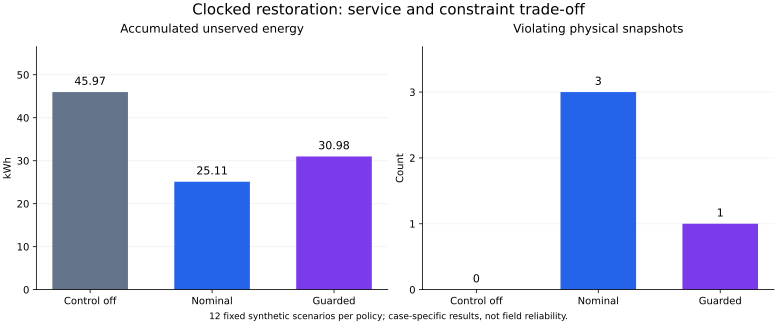

# Clocked restoration comparison

This study compares complete episodes, rather than isolated post-fault snapshots.
The [fixed protocol](../experiments/protocols/sessions.json) contains 12 inspected
teaching-feeder scenarios. Each runs for 12 simulated seconds under automatic
control off, nominal planning and guarded planning: 36 episodes in total.
The scenarios are internal engineering cases, not unseen test data or field records.

## Method

Each policy receives the same initial physical conditions, scheduled events,
measurement settings and horizon. Later observations can differ because an earlier
switching choice changed which loads were supplied. Controls have the same command,
decision and three-operation bounds. Nominal evaluates one demand point; guarded
can evaluate 15 at each tested future switching time, within the same 2,048-call
per-tick native budget. Both use the same public one-second actuation assumption,
zero additional confirmation delay and ten-second energy window. Those extra calls
are part of its measured cost, not free additional information.

Cases include repair of a feeder, distribution transformer and source; busy donors;
unobserved donor demand; failed actuators; late or missing confirmation; refault
during recovery; unseen demand during recovery; a source that remains unavailable;
and delivered demand that invalidates a remaining sequence. None requires a
successful full restoration to count as a completed episode.

The scenario boundary is explicit: private demand and actuator settings drive the
physical engine. The controller receives held native load estimates, device rows,
alarms and its command confirmations. The electrical adapter rebuilds the native
circuit for both predictions and physical outcomes. No true-demand feasibility
veto shields a bad planned action.

Each interval uses the physical state solved at its start. The final sample has
zero duration. Raw service and service in fully compliant states are separate.
Unknown solve intervals have a separate denominator. First full recovery delay is
not a guarantee that later supply remains uninterrupted; a return-to-normal sequence
can interrupt it again. Switching attempts, actual position changes, unresolved
commands, violations and computation cost are retained for every policy/case.

## Sequence and uncertainty checks

The small-case reference tries operation permutations directly, independently of
production ordered-path construction, service-bound pruning and ranking. Four initial
incident views are checked under both policies, plus return to normal under both
policies: ten comparisons. They share the observation model, finite demand samples
the device load-set helper and OpenDSS adapter. Agreement tests the search implementation; it does not provide
independent validation of electrical physics or global optimality beyond the bound.

Three selected incident plans per policy are also evaluated over a joint grid of
three levels within the initial bounds for each of six load groups: 729 finite points per plan, 4,374 plan/point
checks overall. Every applicable intermediate step is solved. Checks stop a sequence
at its first violating step and retain that outcome. A selected hold is tested as
a hold; avoiding an overload by leaving demand disconnected is not full restoration.
This grid includes combinations omitted by the 15-point planning set. It still
cannot prove feasibility at every continuous demand value or outside the bounds.

## Results and reproduction



The figure reads the complete included result summary directly. Its counts are
case-specific synthetic observations, with no inferred field reliability.


Recorded on 12 October 2026. Totals sum twelve 12-second cases per policy;
they are not field reliability or failure rates.

| Policy | Unserved kWh | Critical kWh in compliant states | Violating snapshots | Commands | Planning solves | Median episode wall time |
| --- | ---: | ---: | ---: | ---: | ---: | ---: |
| Off | 45.972 | 1.333 | 0 | 0 | 0 | 0.11 s |
| Nominal | 25.111 | 10.111 | 3 | 31 | 1,025 | 1.33 s |
| Guarded | 30.983 | 9.444 | 1 | 48 | 4,640 | 3.32 s |

All 36 episodes finished the same horizon, with no unknown native intervals or
exhausted per-tick budgets. The sequence reference matched all ten comparisons.
The study took 175.00 seconds: 6,133 native calls for episodes
(including 468 physical snapshots), 14,380 for permutation checks and
7,290 for dense uncertainty checks. These are adapter calls, not native
solver iterations. Wall times describe this one host and fixed execution order.

| Initial incident plan | Nominal violations / 729 points | Guarded violations / 729 points |
| --- | ---: | ---: |
| Feeder repair | 102 | 0 |
| Busy donors | 81 | 0 |
| Stale east demand | 117 | 0 |

Guarded reduced the observed violation count, but lost more total and compliant
critical service, issued more commands and required more computation. Its finite
demand samples do not guarantee continuous safety or good performance outside the
assumed range. Avoiding violations by holding or shedding demand is not full
restoration. Off has zero violations here because it leaves interrupted demand
disconnected.

The stale-east-demand nominal case has two violating snapshots. Delivered loading
shows an overload despite held load estimates. Corrective shedding and remembered
load exposure prevent repeatedly restoring the same known unsafe combination;
they do not make the preceding stale prediction physically correct. The trace
retains both violations and the later service loss.

An unseen demand increase during recovery causes one violating snapshot under
each active policy. It occurs before new received evidence can change the
command. The nominal late- and lost-confirmation cases finish with unresolved
commands. Repair, electrical supply and confirmed return to normal remain
separate outcomes.

Plans age held bounds at assumed switching times and compare transition energy;
[execution planning](EXECUTION_PLANNING.md) defines the assumptions. Revalidation
still runs before the next command. A cold, disconnected load cannot supply a
fresh demand estimate, so partial service may persist; the
[measurement-refresh study](MEASUREMENT_REFRESH.md) records that limitation.
The finite joint-grid audit uses the initial bounds and does not test every
later bound expansion or every future tick.

[Complete results](../experiments/session_results/results.json) retain all episode
summaries, reference comparisons and finite-grid outcomes. [Compressed traces](../experiments/session_results/episodes.jsonl.gz)
retain every physical frame, received row, decision, command and confirmation.
The report pins source, protocol, reference enumerator, native version and trace
bytes. These are inspected synthetic engineering cases, not an unseen holdout.

```bash
python experiments/run_session_benchmark.py --output-dir var/session-study
python experiments/run_session_benchmark.py --output-dir var/session-study --verify-report
```

Use a new directory. The checker recomputes interval totals from stored physical
frames and checks counts, fingerprints and per-tick solve budgets. It does not
rerun the complete campaign; the first command does. Strict episode replay is
also exercised by the restoration example, measurement-refresh exports and
browser/runtime checks. Export and checkers sharing code do not establish
independent utility validation.
